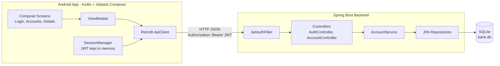
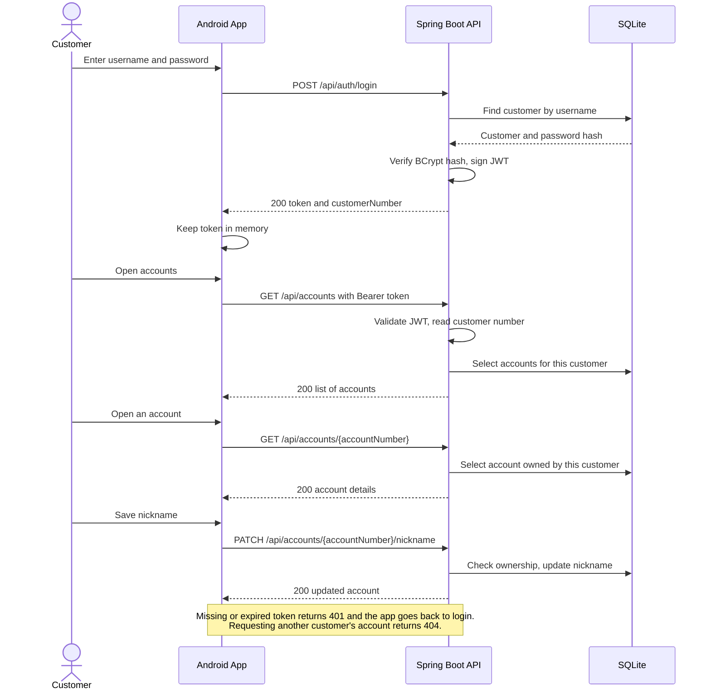

# Bank App

A native Android app for bank customers to log in, view their accounts, see account details, and set an account nickname. Built with a Spring Boot backend and SQLite database.

## Tech stack

**Android:** Kotlin, Jetpack Compose, MVVM (ViewModel), Retrofit + Gson, Navigation Compose. Fully native, no cross-platform frameworks.

**Backend:** Java 17, Spring Boot, Spring Security, JWT (jjwt), Spring Data JPA / Hibernate, SQLite. Runs locally, no cloud services.

## Architecture



## Application communication



## Data model

| Field | Type | Length | Rule |
|---|---|---|---|
| Customer Number | Integer | 9 | Primary key of customers, unique per customer |
| Account Number | String | 9 | Primary key of accounts, unique globally |
| Balance | Float | - | |
| Nickname | String | 255 | Optional, validated on app and server |

Passwords are stored as BCrypt hashes, never plain text.

## API

| Method | Endpoint | Auth | Description |
|---|---|---|---|
| POST | /api/auth/login | Public | Returns a JWT for valid credentials |
| GET | /api/accounts | JWT | Lists the logged-in customer's accounts |
| GET | /api/accounts/{accountNumber} | JWT | Account details, only if owned by the customer |
| PATCH | /api/accounts/{accountNumber}/nickname | JWT | Updates the nickname (max 255 characters) |

## Security decisions

- All account endpoints require a valid JWT. The token is signed and expires after 1 hour.
- The customer number is always taken from the token, never from the request, so a customer cannot access another customer's accounts by changing the account number in the URL.
- The server is stateless (no sessions). Each request is authenticated by its token.
- The app keeps the token in memory only, so closing the app logs the user out.
- Plain HTTP is allowed only for local development addresses through a network security config. Production would use HTTPS only.

## How to run

**Requirements:** JDK 17, Android Studio, an Android emulator.

**1. Start the backend**

```
cd backend
./mvnw spring-boot:run
```

On Windows use `.\mvnw.cmd spring-boot:run`. The SQLite database file `bank.db` is created automatically and seeded with test data on first run.

**2. Connect the emulator to the backend**

With the emulator running:

```
adb reverse tcp:8080 tcp:8080
```

This forwards the emulator's `localhost:8080` to the computer's backend. Run it again if the emulator restarts.

**3. Run the app**

Open the `android` folder in Android Studio and press Run.

## Test accounts

| Username | Password | Accounts |
|---|---|---|
| ahmad | password123 | 200000001, 200000002 |
| sara | password123 | 200000003 |

## Notes and possible improvements

- Balance uses Float as specified. For real money I would use BigDecimal / DECIMAL to avoid rounding errors.
- Refresh tokens, login rate limiting and account lockout would be added for production.
- Encrypted token storage (Android Keystore) if "remember me" is needed.
- Unit and integration tests for the service layer and API.
